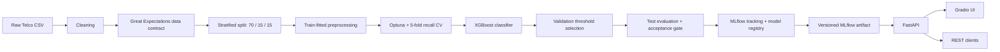

# Telco Customer Churn Prediction

**End-to-end Machine Learning and MLOps pipeline for retention-oriented churn detection in telecommunications**

[](https://github.com/nadasd/telco-customer-churn-ml/actions/workflows/ci.yml)
[](https://github.com/nadasd/telco-customer-churn-ml/actions/workflows/pipeline-smoke.yml)


## Project Overview

This project delivers a reproducible ML system that estimates the probability of customer churn from 19 account, service, and billing attributes. It covers the complete path from raw telecom data to a validated prediction service: data contracts, leakage-aware splitting, preprocessing, hyperparameter optimization, business-aligned threshold selection, experiment tracking, model packaging, REST inference, an interactive interface, automated tests, and containerized execution.

The maintained pipeline trains an XGBoost classifier and packages cleaning, preprocessing, inference, and the selected decision threshold into a single MLflow `pyfunc` artifact. A FastAPI service and Gradio application consume the same versioned artifact, reducing training-serving skew.


## Business Problem & Objectives

Customer churn is a high-impact challenge for telecom operators: once a customer has left, reacquisition is usually more expensive than a timely and relevant retention action. The modeling objective is therefore not limited to maximizing overall accuracy. It is to identify as many at-risk customers as possible while keeping the retention audience sufficiently precise to remain actionable.

The project implements this objective explicitly:

- **Primary objective:** maximize churn recall to reduce missed at-risk customers.
- **Operational constraint:** require at least 40% precision during threshold selection.
- **Decision policy:** select the threshold on the validation set, then report final performance once on the untouched test set.
- **Serving output:** return both a churn score and a threshold-based binary decision.

This makes the classification threshold a business control: it can reflect the relative cost of a missed churner versus the cost of contacting a customer who would have stayed.


## Key Features

| Capability | Implementation |
| --- | --- |
| Data quality | Great Expectations checks required columns, nulls, categorical domains, target values, and numeric ranges |
| Reproducible splitting | Deterministic, stratified 70% train / 15% validation / 15% test split with seed 42 |
| Leakage control | Preprocessing is fitted on training data; threshold selection uses validation data; test data is reserved for final evaluation |
| Feature processing | Numeric standardization and one-hot encoding with safe handling of unseen categories |
| Model optimization | 100 Optuna TPE trials with five-fold cross-validation and recall as the optimization objective |
| Decision strategy | Validation search from 0.05 to 0.50 in 0.01 increments, maximizing recall under a minimum precision constraint |
| Model governance | Explicit acceptance gate for precision, recall, F1, and train-test F1 gap |
| Experiment tracking | MLflow parameters, split metrics, CV stability, data hash, Git commit, plots, artifacts, and model registration |
| Inference contract | Self-contained MLflow model with a 19-feature schema, signature, runtime metadata, threshold, and reference output |
| Application layer | Validated FastAPI endpoints plus a Gradio interface backed by the API |
| Delivery | Three Docker images, Docker Compose orchestration, health checks, 24 pytest cases, and three GitHub Actions workflows |

## System Architecture




The versioned artifact contains the raw-input cleaner, fitted feature transformer, trained classifier, decision threshold, schema, model signature, dependency specification, and evaluation metadata. The API can therefore load `model/` directly without requiring a live tracking server for inference.


## Technology Stack

| Layer | Technologies |
| --- | --- |
| Language and data | Python 3.12, pandas, NumPy |
| Machine learning | scikit-learn, XGBoost |
| Optimization | Optuna, stratified cross-validation |
| Data validation | Great Expectations |
| Experiment management | MLflow Tracking and Model Registry |
| API and contracts | FastAPI, Pydantic, Uvicorn |
| User interface | Gradio |
| Quality engineering | pytest, FastAPI TestClient |
| Packaging and orchestration | Docker, Docker Compose |
| Continuous integration | GitHub Actions |

## Machine Learning Pipeline

1. **Load and clean** — reads the canonical Telco CSV, normalizes names and categorical values, removes the customer identifier, converts `TotalCharges`, handles blanks, and encodes the target.
2. **Validate the data contract** — checks the 20 cleaned columns, missing values, allowed service categories, binary fields, tenure range, and non-negative charges. The pipeline stops on validation failure.
3. **Create isolated data splits** — produces deterministic and stratified train, validation, and test partitions.
4. **Build preprocessing** — standardizes numeric variables and one-hot encodes categorical variables with safe handling of unknown categories.
5. **Optimize XGBoost** — searches seven hyperparameters with a seeded TPE sampler and five-fold recall scoring.
6. **Assess CV stability** — records the mean and standard deviation of cross-validation recall for the selected configuration.
7. **Train the final estimator** — fits preprocessing and XGBoost on the training partition only.
8. **Select the operating threshold** — chooses the validation threshold with the highest recall among candidates meeting the precision floor; F1 breaks recall ties.
9. **Evaluate and gate** — computes train, validation, and test metrics, generalization gaps, confusion matrix data, ROC-AUC, and PR-AUC before model export.
10. **Package and register** — logs an MLflow `pyfunc` artifact with an explicit model signature and registers it as `TelcoChurnXGBoost`.

All training controls are centralized in [`configs/training.toml`](configs/training.toml), including random seeds, split proportions, search space, threshold policy, MLflow names, and acceptance criteria.


## Model Performance & Evaluation

The following values describe the packaged deployment artifact, **MLflow registry version 4** of `TelcoChurnXGBoost`, identified in [`model/registered_model_meta`](model/registered_model_meta). They match its [`model/MLmodel`](model/MLmodel) metadata and the held-out test evaluation recorded in MLflow. New training runs create separate registry versions; local inference uses the committed `model/` artifact until it is explicitly replaced.

| Metric | Test result | Interpretation |
| --- | ---: | --- |
| **Recall** | **91.46%** | Captures 257 of the 281 churners in the test set |
| **Precision** | **40.60%** | More than two in five retention targets are true churners |
| **F1-score** | **56.24%** | Harmonic balance at the recall-oriented operating point |
| ROC-AUC | 83.76% | Ranking quality across all classification thresholds |
| Average precision (logged as PR-AUC) | 66.50% | Precision-recall quality for the positive churn class |
| Accuracy | 62.16% | Overall correctness at the selected operating point |
| **Decision threshold** | **0.10** | Converts predicted churn probability into the intervention decision |

### Confusion matrix at threshold 0.10

| Actual / Predicted | Stay | Churn | Total |
| --- | ---: | ---: | ---: |
| Stay | 400 | 376 | 776 |
| Churn | 24 | 257 | 281 |
| **Total** | **424** | **633** | **1,057** |

The lower threshold deliberately expands the retention audience to protect recall. On unseen test data, the model misses only 24 churners while identifying 257. The resulting false positives are the explicit cost of a high-coverage retention strategy; the validation-time precision floor prevents the candidate list from becoming indiscriminately broad.

The pipeline also applies the following model acceptance rules before exporting and registering the artifact:

| Gate | Required value |
| --- | ---: |
| Precision | ≥ 0.40 |
| Recall | ≥ 0.85 |
| F1-score | ≥ 0.50 |
| Train-test F1 gap | ≤ 0.10 |


## MLOps & Deployment

### Experiment tracking and reproducibility

Each MLflow run records:

- Optuna parameters, seed, trial count, CV setup, and selected threshold;
- train, validation, and test metrics, including confusion-matrix counts and predicted-positive rate;
- cross-validation mean and standard deviation plus train-validation-test generalization gaps;
- dataset dimensions, SHA-256 fingerprint, source path, and Git commit;
- test confusion matrix, ROC curve, precision-recall curve, validation threshold curve, and a JSON metrics summary;
- model signature, raw feature schema, input example, dependency environment, runtime versions, and artifact version.

The committed `model/` directory is a directly loadable MLflow artifact. Its inference pipeline validates and orders all 19 raw fields, applies the same cleaning and preprocessing used during training, then returns `churn_probability` and `churn_prediction`.

### API contract

| Method | Endpoint | Purpose |
| --- | --- | --- |
| `GET` | `/` | Service metadata and documentation link |
| `GET` | `/health` | Model loading and readiness check |
| `POST` | `/predict` | Validated single-customer churn inference |
| `GET` | `/docs` | Interactive OpenAPI / Swagger documentation |

Pydantic rejects missing fields, unknown fields, invalid service categories, and out-of-range numeric values before inference.

### Containerized services

| Service | Port | Role |
| --- | ---: | --- |
| MLflow | 5000 | Local tracking server, SQLite backend, artifact store, and registry |
| FastAPI | 8000 | Prediction API loading the packaged model |
| Gradio | 7860 | Interactive client communicating with FastAPI |

Docker Compose defines dedicated images, service environment variables, API and MLflow health checks, and dependency-aware UI startup.

### Automated validation and CI

- `ci.yml` validates the Compose configuration, checks Python syntax, runs the standard test suite against the packaged artifact, and builds the API and UI images.
- `pipeline-smoke.yml` executes the real training orchestration with a lightweight Optuna configuration, verifies MLflow provenance, reloads the serialized artifact, and checks its prediction contract.
- `pipeline-validation.yml` runs the full configured training on manual dispatch, downloads the reference IBM dataset at a pinned revision, verifies its SHA-256 checksum, and starts an isolated MLflow server on the runner.
- The test suite covers cleaning, Great Expectations validation, split integrity and determinism, preprocessing, threshold logic, evaluation metrics, MLflow serialization, API behavior, artifact/API parity, UI integration, and end-to-end orchestration.


## Project Structure

```text
telco-customer-churn-ml/
├── .github/workflows/       # CI and pipeline smoke workflows
├── configs/training.toml    # Training and acceptance configuration
├── data/                    # Local data, excluded from Git
├── docs/architecture.md     # Deployment architecture notes
├── gx/                      # Great Expectations configuration
├── model/                   # Versioned MLflow model artifact
├── notebooks/archive/       # Historical EDA and experiments
├── scripts/run_pipeline.py  # End-to-end training orchestration
├── src/
│   ├── api/                 # FastAPI schemas, service, and endpoints
│   ├── ui/                  # Gradio application
│   ├── clean.py             # Canonical data cleaning
│   ├── validate_data.py     # Data quality contract
│   ├── preprocess.py        # Feature transformation
│   ├── tune.py              # Optuna search
│   ├── train.py             # Final model fitting
│   ├── select_threshold.py  # Business-aligned decision policy
│   ├── evaluate.py          # Classification and ranking metrics
│   ├── model_validation.py  # Diagnostics and CV stability
│   ├── model_acceptance.py  # Promotion gate
│   └── model_artifact.py    # MLflow inference model
├── tests/                   # Unit, integration, contract, and smoke tests
├── Dockerfile               # FastAPI image
├── Dockerfile.mlflow        # MLflow image
├── Dockerfile.ui            # Gradio image
├── compose.yaml             # Local service orchestration
└── requirements*.txt        # Runtime, test, and UI dependencies
```


## Getting Started

### 1. Clone and install

**Prerequisites:** Git, Python 3.12, and optionally Docker with Docker Compose.

```bash
git clone https://github.com/nadasd/telco-customer-churn-ml.git
cd telco-customer-churn-ml
python -m venv .venv
```

Activate the environment:

```bash
# Linux / macOS
source .venv/bin/activate

# Windows PowerShell
./.venv/Scripts/Activate.ps1
```

Install all local development dependencies:

```bash
python -m pip install --upgrade pip
python -m pip install -r requirements.txt -r requirements-dev.txt -r requirements-ui.txt
```

### 2. Add the dataset

Download the [reference IBM Telco Customer Churn CSV](https://raw.githubusercontent.com/IBM/telco-customer-churn-on-icp4d/d5371f5d83a446ad5673cbcca3b814b926491f8a/data/Telco-Customer-Churn.csv) and save it at the configured location:

```text
data/raw/WA_Fn-UseC_-Telco-Customer-Churn.csv
```

The expected raw schema contains `customerID`, the 19 model features, and the `Churn` target. Data and locally generated MLflow state are intentionally excluded from Git.

### 3. Train and register the model

Start the local MLflow server in the first terminal:

```bash
mlflow server --backend-store-uri sqlite:///mlflow.db --artifacts-destination ./mlartifacts --host 127.0.0.1 --port 5000
```

Run the complete training pipeline from a second activated terminal:

```bash
python scripts/run_pipeline.py
```

MLflow experiments and registered models are available at [http://127.0.0.1:5000](http://127.0.0.1:5000).


### 4. Run the packaged model locally

The repository includes a versioned model in `model/`, so inference can start without retraining:

```bash
python -m uvicorn src.api.main:app --host 0.0.0.0 --port 8000
```

Open [http://127.0.0.1:8000/docs](http://127.0.0.1:8000/docs) to inspect the 19-field schema and submit predictions interactively.

Start the Gradio client in another terminal:

```bash
python -m src.ui.app
```

Then open [http://127.0.0.1:7860](http://127.0.0.1:7860). A successful prediction returns `churn_probability`, `churn_prediction`, and the loaded `model_uri`.

### 5. Run with Docker Compose

Start the API and UI with the committed artifact:

```bash
docker compose up --build api ui
```

To include the local MLflow server, first create the bind-mount targets used by `compose.yaml`:

```bash
# Linux / macOS
touch mlflow.db
mkdir -p mlartifacts
docker compose up --build
```

```powershell
# Windows PowerShell
if (-not (Test-Path -LiteralPath mlflow.db)) { New-Item -ItemType File -Path mlflow.db }
New-Item -ItemType Directory -Path mlartifacts -Force
docker compose up --build
```

Stop the stack with `docker compose down`.


### 6. Run the tests

Run the same standard suite used by CI against the committed model:

```bash
# Linux / macOS
TELCO_MODEL_URI=model python -m pytest -v --ignore=tests/test_pipeline_smoke.py
```

```powershell
# Windows PowerShell
$env:TELCO_MODEL_URI = 'model'
python -m pytest -v --ignore=tests/test_pipeline_smoke.py
```

Run the real orchestration smoke test separately:

```bash
python -m pytest tests/test_pipeline_smoke.py -v -s
```

## Technical Highlights

- **Business-aligned modeling:** recall is optimized under a measurable precision constraint instead of relying on the default 0.50 threshold.
- **Sound evaluation design:** tuning, threshold selection, and final reporting use distinct train, validation, and test responsibilities.
- **Training-serving consistency:** the deployable artifact owns cleaning, feature transformation, classifier inference, schema validation, and decision policy.
- **Traceable experimentation:** dataset fingerprint, source revision, configuration, metrics, diagnostics, and runtime versions are retained with each run.
- **Quality gates:** data validation and model acceptance stop the pipeline before an unsuitable artifact is promoted.
- **Service-oriented delivery:** typed REST inference, interactive UI, health checks, containers, contract tests, and CI demonstrate the full ML engineering lifecycle.

## Author

**Nada Sadraoui**<br>
AI & Data Engineering Student<br>
[GitHub](https://github.com/nadasd)
